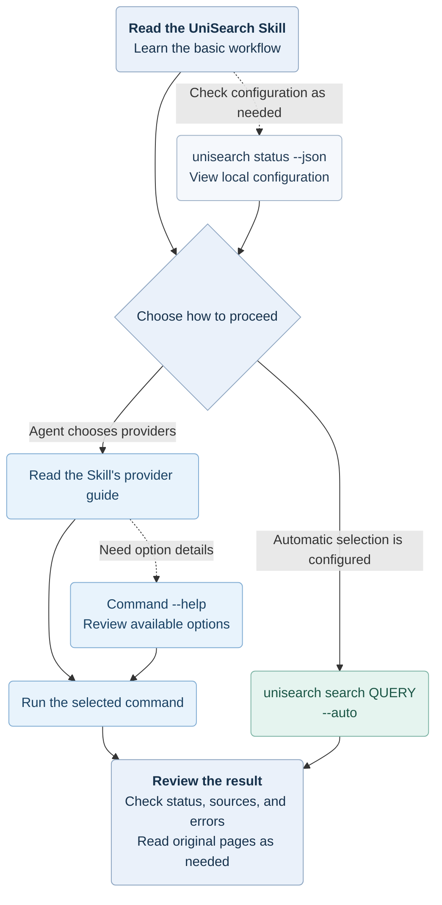

<p align="center">
  
</p>

<h1 align="center">UniSearch</h1>

<p align="center">
  English · <a href="README.zh-CN.md">简体中文</a>
</p>

<p align="center">
  <a href="https://www.npmjs.com/package/unisearch-cli"></a>
  
  <a href="LICENSE"></a>
</p>

UniSearch is a unified retrieval CLI for AI agents. It supports web search, page reading, site link discovery, and documentation lookup for libraries and code repositories.

Searches can use a configured model or web search services. Search sources can be specified manually or selected by UniSearch based on the query.

## Supported services

UniSearch supports model APIs using Responses or Chat Completions, along with [Exa](https://exa.ai/), [Tavily](https://www.tavily.com/), [Firecrawl](https://www.firecrawl.dev/), [Context7](https://context7.com/), [Jina AI](https://jina.ai/), Zhipu API ([BigModel](https://docs.bigmodel.cn/cn/guide/tools/web-search) / [Z.AI](https://docs.z.ai/guides/tools/web-search)), Zhipu MCP ([BigModel](https://docs.bigmodel.cn/cn/coding-plan/mcp/search-mcp-server) / [Z.AI](https://docs.z.ai/devpack/mcp/search-mcp-server)), [AnySearch](https://www.anysearch.com/), [TinyFish Search](https://www.tinyfish.ai/search), and [DeepSeek Search & Fetch](https://api-docs.deepseek.com/guides/search/).

For a model to search the web, the model service must provide a search tool and the tool must be enabled in the UniSearch configuration. See [model settings](docs/en/configuration.md#model-settings) for how to configure the API address, model, and tools. See [service settings](docs/en/configuration.md#service-settings) for default API addresses and credential requirements.

## Install

Use Node.js 24 or later and npm on Linux, macOS, or Windows.

```sh
npm install -g unisearch-cli
unisearch --version
```

Ensure `unisearch` is available on the PATH of the process running your agent.

## Configure

Open the configuration menu in an interactive terminal to enter service credentials, set up unified search, and install the Skill for your agents:

```sh
unisearch setup
```

If an interactive terminal is unavailable, use `unisearch config set` or environment variables instead. After configuring, check the configuration as needed:

- `unisearch status` checks local configuration only and sends no network requests.
- `unisearch doctor` runs online checks for enabled services with usable diagnostic settings and may consume quota. `unisearch doctor PROVIDER` checks only the specified service; for example, `unisearch doctor exa` checks Exa.

See [Configuration](docs/en/configuration.md) for all fields, how credentials are stored, environment variables, model protocols, and troubleshooting.

## First search

This example uses only Exa. Configure the Exa API key in `setup` first; no model configuration is needed:

```sh
unisearch search 'Node.js 24 LTS release schedule' --sources exa
```

`--sources` sets the sources for this search. Without it, the search uses the source list configured in `search.providers`; the default list contains only `model` and requires model settings.

Use `unisearch fetch URL` to read a page and `unisearch map URL` to discover links within a site. `unisearch --help` lists all commands, and the [design overview](docs/en/design.md) explains source selection, failure handling, and exit codes.

## Connect an agent

If you did not add the UniSearch Skill during `setup`, use `unisearch skills install` to add it and `unisearch skills status` to check the installed copies.

```sh
unisearch skills install --targets codex,claude
unisearch skills status --targets codex,claude
```

The example installs the Skill under `~/.codex/skills/` and `~/.claude/skills/`. Omit `--targets` during installation to select agents interactively. Omit it in `unisearch skills status` to check all targets. `unisearch skills install --help` lists the supported targets.

`unisearch skills install` creates missing copies and synchronizes existing ones with the bundled version. Synchronizing replaces the entire `unisearch` Skill directory under the agent's directory, so local edits in it are lost. `unisearch skills status` only compares the installed copies with the bundled version and does not modify files.



## Upgrade and uninstall

Upgrade the CLI and synchronize installed Skill copies:

```sh
npm update -g unisearch-cli
unisearch skills update --targets codex,claude
```

To remove the Skill copies and uninstall the CLI:

```sh
unisearch skills remove --targets codex,claude
npm uninstall -g unisearch-cli
```

Use the targets you actually installed. Running npm uninstall alone preserves both configuration and Skill copies. To delete configuration as well, locate it with `unisearch config path` before uninstalling and remove that file separately.

## Contributing

See the [contributing guide](https://github.com/ADabbler/unisearch/blob/main/CONTRIBUTING.md) for development and contribution instructions. Report problems through [Issues](https://github.com/ADabbler/unisearch/issues).

## Reference project

UniSearch was rebuilt with reference to [Smart Search](https://github.com/konbakuyomu/smartsearch).

## License

This project is licensed under the [MIT License](LICENSE).

## Acknowledgements

Thanks to the [LINUX DO](https://linux.do/) community.
