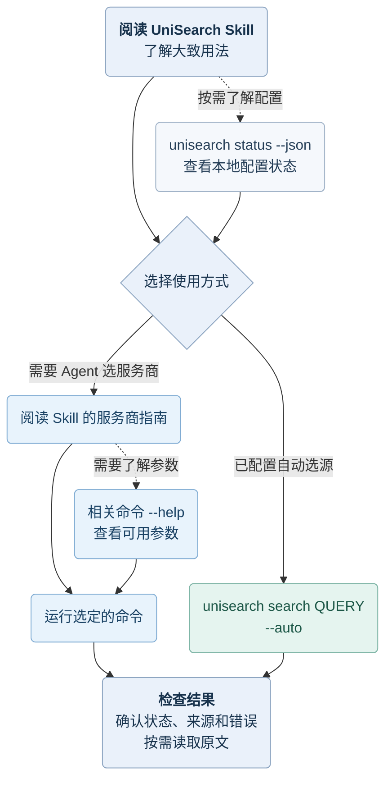

<p align="center">
  
</p>

<h1 align="center">UniSearch</h1>

<p align="center">
  <a href="README.md">English</a> · 简体中文
</p>

<p align="center">
  <a href="https://www.npmjs.com/package/unisearch-cli"></a>
  
  <a href="LICENSE"></a>
</p>

UniSearch 是面向 AI Agent 的统一检索 CLI，支持网页搜索、正文读取、站内链接发现，以及软件库和代码仓库文档查询。

搜索可使用已配置的模型或网页搜索服务。搜索来源可手动指定，也可由 UniSearch 按查询自动选择。

## 支持的服务

支持使用 Responses 或 Chat Completions 接口的模型 API，以及 [Exa](https://exa.ai/)、[Tavily](https://www.tavily.com/)、[Firecrawl](https://www.firecrawl.dev/)、[Context7](https://context7.com/)、[Jina AI](https://jina.ai/)、智谱 API（[BigModel](https://docs.bigmodel.cn/cn/guide/tools/web-search) / [Z.AI](https://docs.z.ai/guides/tools/web-search)）、智谱 MCP（[BigModel](https://docs.bigmodel.cn/cn/coding-plan/mcp/search-mcp-server) / [Z.AI](https://docs.z.ai/devpack/mcp/search-mcp-server)）、[AnySearch](https://www.anysearch.com/)、[TinyFish Search](https://www.tinyfish.ai/search) 和 [DeepSeek 搜索与抓取](https://api-docs.deepseek.com/zh-cn/guides/search/)。

模型联网检索需要模型服务提供搜索工具，并在 UniSearch 的配置中启用。API 地址、模型和工具的配置方法见[模型配置](docs/zh-CN/configuration.md#模型配置)。各服务的默认 API 地址和凭证要求见[服务配置](docs/zh-CN/configuration.md#服务配置)。

## 安装

在 Linux、macOS 或 Windows 上使用 Node.js 24 或更高版本及 npm。

```sh
npm install -g unisearch-cli
unisearch --version
```

确保运行 Agent 的进程能通过 PATH 找到 `unisearch`。

## 配置

在交互式终端中打开配置菜单，填写服务凭证、设置统一搜索，并为 Agent 安装 Skill：

```sh
unisearch setup
```

无法使用交互式终端时，可改用 `unisearch config set` 或环境变量。配置后可按需检查：

- `unisearch status` 只检查本地配置，不发起网络请求。
- `unisearch doctor` 联网检查已启用且具备诊断配置的服务，可能消耗额度。`unisearch doctor PROVIDER` 只检查指定服务，例如 `unisearch doctor exa` 只检查 Exa。

全部字段、凭证的保存方式、环境变量、模型协议和排障步骤见[配置文档](docs/zh-CN/configuration.md)。

## 首次搜索

以下示例仅使用 Exa。先在 `setup` 中配置 Exa 的 API Key，无需配置模型：

```sh
unisearch search 'Node.js 24 LTS release schedule' --sources exa
```

`--sources` 指定本次搜索的来源。省略时使用 `search.providers` 配置的来源列表；默认列表仅包含 `model`，需要完成模型配置。

使用 `unisearch fetch URL` 读取网页，使用 `unisearch map URL` 发现站内链接。全部命令见 `unisearch --help`，选源规则、失败处理和退出码见[设计概览](docs/zh-CN/design.md)。

## 接入 Agent

如果没有在 `setup` 中安装 UniSearch Skill，可以用 `unisearch skills install` 安装，再用 `unisearch skills status` 检查副本。

```sh
unisearch skills install --targets codex,claude
unisearch skills status --targets codex,claude
```

上面的命令把 Skill 安装到 `~/.codex/skills/` 和 `~/.claude/skills/`。安装时省略 `--targets` 可交互选择 Agent。检查时省略它则查看全部目标。支持的目标见 `unisearch skills install --help`。

`unisearch skills install` 创建缺少的副本，并把已有副本同步为随包版本。同步会替换 Agent 目录下的整个 `unisearch` Skill 目录，其中的本地修改会丢失。`unisearch skills status` 只比较副本和随包版本，不修改文件。



## 升级与卸载

升级 CLI 并同步已安装的 Skill：

```sh
npm update -g unisearch-cli
unisearch skills update --targets codex,claude
```

移除 Skill 副本并卸载 CLI：

```sh
unisearch skills remove --targets codex,claude
npm uninstall -g unisearch-cli
```

请使用实际安装过的目标。仅执行 npm uninstall 会保留配置和 Skill 副本。需要同时删除配置时，先在卸载前通过 `unisearch config path` 确认位置，再单独删除该文件。

## 贡献

开发与贡献流程见[贡献指南](https://github.com/ADabbler/unisearch/blob/main/CONTRIBUTING.zh-CN.md)，遇到问题可通过 [Issues](https://github.com/ADabbler/unisearch/issues) 反馈。

## 参考项目

UniSearch 参考 [Smart Search](https://github.com/konbakuyomu/smartsearch) 重构。

## 许可证

本项目采用 [MIT 许可证](LICENSE)。

## 致谢

感谢 [LINUX DO](https://linux.do/) 社区。
